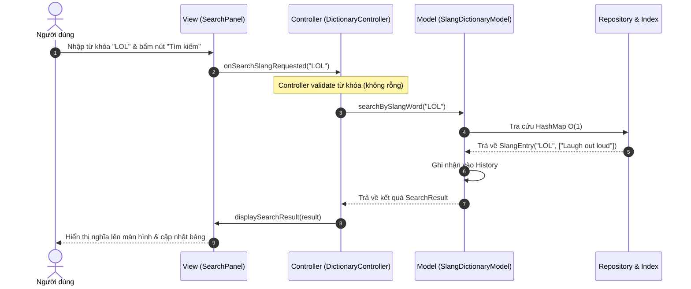
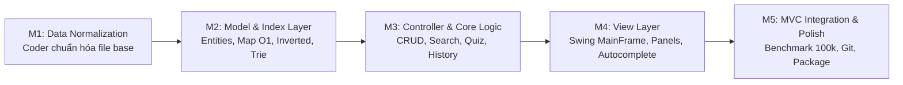

# KẾ HOẠCH TỔNG THỂ & THIẾT KẾ KIẾN TRÚC ĐỒ ÁN SLANG DICTIONARY (CHUẨN MVC)
**Môn học:** CSC13002 – Lập trình ứng dụng Java  
**Đồ án:** DAMH#1 – Slang Word Dictionary (Java Swing + Java 21)  
**Tài liệu tham chiếu:** [DAMH#1.md](file:///D:/HK1-Nam3/JAVA/PA01/DictionaryApp/DAMH#1.md) và [plan.md](file:///D:/HK1-Nam3/JAVA/PA01/DictionaryApp/plan.md)

---

## 0. Đánh giá & Điều chỉnh theo Yêu cầu Người dùng

### 0.1. Vấn đề 1: Chuẩn hóa dữ liệu là công việc một lần duy nhất của Coder
- **Thực tế:** Người dùng cuối (end-user) của ứng dụng từ điển không cần và không nên biết về việc quét lỗi hay sửa dòng hỏng của file `slang.txt`.
- **Giải pháp điều chỉnh:**
  - Quá trình quét và chuẩn hóa file `slang.txt` thành `slang_base.txt` được coder thực hiện **ngay từ đầu (offline)**.
  - Loại bỏ hoàn toàn màn hình `ValidationPanel` khỏi giao diện người dùng của ứng dụng.
  - Ứng dụng khi chạy chỉ làm việc trực tiếp với file đã được chuẩn hóa (`slang_base.txt` làm baseline và `slang_user.txt` làm working copy).
  - Chức năng **Reset** của người dùng chỉ đơn giản là khôi phục `slang_user.txt` về trạng thái nguyên vẹn của `slang_base.txt` mà không cần quét lại gì cả.

### 0.2. Vấn đề 2: Xác định và Chuẩn hóa Thiết kế theo đúng Design Pattern MVC
- **Đánh giá bản phác thảo trước:** Bản trước có xu hướng trộn lẫn giữa Service Layer (kiến trúc phân tầng hướng dịch vụ) và Controller, đồng thời giao tiếp giữa View và Model chưa thể hiện rõ sự phân tách rạch ròi của MVC truyền thống trong Java Swing.
- **Giải pháp chuẩn hóa MVC thuần túy:**
  - **Model (M):** Chịu trách nhiệm quản lý toàn bộ dữ liệu, trạng thái từ điển, các cấu trúc dữ liệu tối ưu ($O(1)$ HashMap, Inverted Index, Prefix Trie, Search History) và các thao tác nghiệp vụ (tìm kiếm, thêm, ghi đè/nhân bản, sửa, xóa, reset, sinh câu hỏi đố vui). Model cung cấp cơ chế thông báo (Observer Pattern / Event Listener) khi dữ liệu thay đổi để View cập nhật.
  - **View (V):** Chịu trách nhiệm hiển thị giao diện đồ họa (Java Swing), bắt các tương tác của người dùng (click chuột, nhập phím) và chuyển giao (delegate) sự kiện cho Controller. **View tuyệt đối không chứa thuật toán tìm kiếm, không đọc ghi file, không thao tác trực tiếp lên cấu trúc dữ liệu.**
  - **Controller (C):** Đóng vai trò cầu nối trung gian. Nhận sự kiện từ View, thực hiện validation đầu vào phía UI, gọi các phương thức nghiệp vụ của Model để thay đổi trạng thái hoặc lấy kết quả, sau đó chỉ định View hiển thị kết quả tương ứng.

---

## 1. Bảng Requirements đối chiếu với Đề bài

| STT | Chức năng / Yêu cầu | Yêu cầu chính thức (`DAMH#1.md`) | Quy định chuẩn hóa MVC | Hiện thực kỹ thuật |
|---|---|---|---|---|
| **F01** | **Tìm kiếm theo Slang Word** | Tìm chính xác slang word. Tốc độ < 1s cho 100.000 từ. | View gửi từ khóa qua Controller $\to$ Model tra cứu $O(1)$ $\to$ Cập nhật View kết quả & History. | `HashMap<String, SlangEntry>` (Key normalized uppercase). Đo thời gian thực tế tính bằng micro-giây. |
| **F02** | **Tìm kiếm theo Definition** | Hiển thị tất cả slang words có definition chứa keyword gõ vào. | View gửi keyword qua Controller $\to$ Model dùng Inverted Index lọc tập ứng viên $\to$ Trả về danh sách cho View. | `InvertedDefinitionIndex` (`Map<String, Set<String>>`) kết hợp substring matching. |
| **F03** | **Hiển thị History** | Danh sách các slang word đã tra cứu. | Model lưu danh sách history và ghi append ra `search_history.txt`. View hiển thị qua `JTable`. | `SearchHistoryEntry` kèm Timestamp, Keyword, Loại tra cứu, Số kết quả. |
| **F04** | **Thêm Slang Word mới** | Nếu trùng thông báo confirm: **Overwrite** hay **Duplicate**. | Controller kiểm tra Model nếu từ đã tồn tại $\to$ View hiển thị Dialog hỏi Overwrite/Duplicate/Cancel $\to$ Model xử lý. | - Overwrite: Thay thế toàn bộ định nghĩa cũ.<br>- Duplicate: Nối thêm định nghĩa mới vào danh sách. |
| **F05** | **Chỉnh sửa (Edit) Slang Word** | Sửa nội dung của một slang word đã có. | Controller nhận dữ liệu sửa từ View $\to$ Model cập nhật Map, Inverted Index, Trie $\to$ Lưu file an toàn. | Hỗ trợ sửa cả từ và danh sách định nghĩa. Re-index tự động. |
| **F06** | **Xóa (Delete) Slang Word** | Confirm trước khi xóa. | View hiển thị confirm dialog $\to$ nếu Yes thì Controller gọi Model xóa từ $\to$ Dọn sạch index $\to$ Lưu file. | `JOptionPane.showConfirmDialog`. Xóa triệt để khỏi Map, Trie và Inverted Index. |
| **F07** | **Reset danh sách gốc** | Khôi phục danh sách slang words gốc. | Confirm dialog $\to$ Controller gọi Model copy `slang_base.txt` sang `slang_user.txt` và nạp lại RAM. | Không sửa đổi `slang_base.txt`. Rebuild lại index và cập nhật toàn bộ View. |
| **F08** | **Random Slang Word** | "On this day slang word": ngẫu nhiên 1 slang word và nghĩa. | Controller gọi Model lấy ngẫu nhiên 1 từ $\to$ View hiển thị trực quan. | Lấy ngẫu nhiên $O(1)$ từ Key List bằng `ThreadLocalRandom`. |
| **F09** | **Đố vui: Slang $\to$ Definition** | Hiển thị 1 random slang word, 4 đáp án definition cho người dùng chọn. | Controller yêu cầu Model sinh câu hỏi (1 đúng, 3 distractors) $\to$ View hiển thị 4 nút bấm $\to$ Kiểm tra kết quả. | `QuizModel` sinh câu hỏi ngẫu nhiên không trùng lặp đáp án. Đổi màu nút (xanh/đỏ) và tính điểm. |
| **F10** | **Đố vui: Definition $\to$ Slang** | Hiển thị 1 definition, 4 đáp án slang words cho người dùng chọn. | Tương tự F09. | Đảo ngược vai trò: câu hỏi là định nghĩa, 4 phương án là các slang words. |
| **Mở rộng** | **Autocomplete** | Gợi ý slang word khi người dùng gõ từng ký tự. | View bắt sự kiện gõ phím (`DocumentListener`) $\to$ Controller lấy danh sách prefix match từ Model $\to$ Hiển thị Popup. | Cấu trúc cây `AutocompleteTrie` tra cứu tiền tố $O(L)$ siêu tốc, không block EDT. |
| **Phi chức năng** | **Lưu Index & Safe Write** | Tốc độ < 1s, lưu lại cấu trúc để lần sau không index lại từ đầu. | Model serialize cấu trúc index xuống `data/index/`. Khi nạp kiểm tra mã băm SHA-256. | Safe atomic write (`.tmp` $\to$ replace) để chống hỏng file khi gặp sự cố. |

---

## 2. Kiến trúc MVC Chuẩn & Tổ chức Mã nguồn

```
D:\HK1-Nam3\JAVA\PA01\DictionaryApp\
├── src\
│   └── vn\edu\hcmus\fit\dictionary\
│       ├── Main.java                             // Khởi chạy ứng dụng (SwingUtilities.invokeLater)
│       │
│       ├── model\                                // [MODEL] Quản lý dữ liệu, logic nghiệp vụ & index
│       │   ├── entity\
│       │   │   ├── SlangEntry.java               // Slang word + List<String> meanings
│       │   │   ├── SearchHistoryEntry.java       // Lịch sử tra cứu
│       │   │   └── QuizQuestion.java             // Câu hỏi trắc nghiệm (đề bài, 4 options, correct index)
│       │   ├── index\
│       │   │   ├── SlangIndex.java               // Tra cứu O(1) theo slang word
│       │   │   ├── InvertedDefinitionIndex.java  // Tra cứu theo definition chứa keyword
│       │   │   ├── AutocompleteTrie.java         // Cây Trie gợi ý tiền tố
│       │   │   ├── TrieNode.java                 // Nút của cây Trie
│       │   │   └── IndexMetadata.java            // Metadata phiên bản & SHA-256
│       │   ├── repository\
│       │   │   ├── SlangRepository.java          // Interface nạp/lưu dữ liệu
│       │   │   └── FileSlangRepository.java      // Xử lý file slang_user.txt và slang_base.txt an toàn
│       │   ├── event\
│       │   │   └── DictionaryModelListener.java  // Interface lắng nghe thay đổi từ Model (Observer Pattern)
│       │   ├── SlangDictionaryModel.java         // Model trung tâm quản lý toàn bộ nghiệp vụ từ điển
│       │   └── QuizModel.java                    // Model quản lý trạng thái, ngân hàng câu hỏi và điểm số quiz
│       │
│       ├── controller\                           // [CONTROLLER] Điều phối sự kiện từ View sang Model
│       │   ├── DictionaryController.java         // Xử lý: Search, Add, Edit, Delete, Reset, History
│       │   ├── QuizController.java               // Xử lý: Tạo câu hỏi quiz, nộp đáp án, thống kê điểm
│       │   └── AutocompleteController.java       // Xử lý: Bắt sự kiện gõ phím, gọi Trie, đổ dữ liệu vào Popup
│       │
│       ├── view\                                 // [VIEW] Giao diện Java Swing thuần túy
│       │   ├── MainFrame.java                    // Khung chính, Sidebar menu điều hướng, CardLayout
│       │   ├── SearchPanel.java                  // Giao diện tra cứu Slang Word và Definition
│       │   ├── ManagementPanel.java              // Giao diện Thêm, Sửa, Xóa, Reset
│       │   ├── HistoryPanel.java                 // Giao diện hiển thị bảng lịch sử
│       │   ├── RandomPanel.java                  // Giao diện "On this day slang word"
│       │   ├── QuizPanel.java                    // Giao diện 2 chế độ đố vui tương tác
│       │   └── component\
│       │       ├── AutocompletePopup.java        // Dropdown menu hiển thị danh sách từ gợi ý
│       │       └── SlangTableModel.java          // TableModel hiển thị dữ liệu lên JTable
│       │
│       └── util\                                 // Tiện ích phụ trợ
│           ├── Constants.java                    // Hằng số đường dẫn, delimiter
│           ├── FileUtils.java                    // Thao tác file atomic, SHA-256 checksum
│           └── TextNormalizer.java               // Chuẩn hóa chuỗi, tách từ khóa
│
├── data\                                         // Thư mục dữ liệu ứng dụng
│   ├── slang.txt                                 // File dữ liệu nguồn ban đầu (read-only)
│   ├── slang_base.txt                            // File baseline do coder chuẩn hóa từ đầu (read-only khi app chạy)
│   ├── slang_user.txt                            // File làm việc chính thức (lưu add/edit/delete)
│   ├── search_history.txt                        // Lưu lịch sử tra cứu
│   └── index\                                    // Thư mục chứa index serialized để tăng tốc khởi động
│       ├── slang_index.ser
│       ├── def_index.ser
│       └── metadata.properties
```

---

## 3. Cơ chế Phân tách Trách nhiệm trong MVC

### 3.1. Sơ đồ Tương tác MVC Chuẩn



### 3.2. Quy tắc Bất di bất dịch của MVC trong dự án:
1. **View:**
   - Không được `import` package `repository` hay `index`.
   - Mọi nút bấm, phím nhấn chỉ kích hoạt phương thức tương ứng trong `Controller`.
   - Đăng ký làm `DictionaryModelListener` để tự động vẽ lại bảng khi Model phát tín hiệu dữ liệu thay đổi (sau khi Add/Edit/Delete/Reset).
2. **Controller:**
   - Giữ tham chiếu đến `Model` và `View`.
   - Đảm bảo thực thi các tác vụ nặng (như Rebuild Index) trên luồng phụ (`SwingWorker`) để không bao giờ làm đơ Event Dispatch Thread (EDT) của Swing.
3. **Model:**
   - Giữ toàn vẹn trạng thái dữ liệu trong RAM.
   - Khi có thay đổi dữ liệu, Model gọi `FileSlangRepository` lưu an toàn ra `slang_user.txt` và cập nhật các cấu trúc Index (`HashMap`, `InvertedIndex`, `Trie`).

---

## 4. Thiết kế Cấu trúc Dữ liệu & Lưu trữ (Data & Index)

### 4.1. Cấu trúc trong Bộ nhớ (RAM)
- **Tra cứu Slang Word ($O(1)$):**  
  `HashMap<String, SlangEntry>` với Key là từ slang chuẩn hóa viết hoa. Mỗi `SlangEntry` chứa từ gốc và `List<String> meanings`.
- **Tra cứu Definition (Inverted Index):**  
  `Map<String, Set<String>>` ánh xạ từ mỗi token trong định nghĩa đến tập hợp các slang words. Khi người dùng tìm keyword gồm nhiều từ, hệ thống tìm giao các tập hợp ứng viên và kiểm tra substring match. Thời gian phản hồi $< 10$ ms cho 100.000 từ.
- **Autocomplete Tiền tố ($O(L)$):**  
  `AutocompleteTrie` cây tiền tố lưu trữ danh sách từ khóa. Khi người dùng gõ chuỗi độ dài $L \le 10$, Trie trả về tối đa 10 gợi ý trong $< 0.1$ ms.
- **Lịch sử Tra cứu:**  
  `LinkedList<SearchHistoryEntry>` trong RAM kết hợp ghi nối tiếp (`append`) vào `data/search_history.txt`.
- **Ngân hàng Đố vui (Quiz):**  
  `QuizModel` duy trì danh sách tham chiếu ngẫu nhiên `ArrayList<SlangEntry>` để bốc ngẫu nhiên câu hỏi và 3 phương án nhiễu (distractors) bằng `ThreadLocalRandom` trong $O(1)$.

### 4.2. Cơ chế Lưu Index & Xác thực Toàn vẹn (Cache Validation)
- Lần đầu chạy hoặc khi có thay đổi: Model serialize `SlangIndex` và `InvertedDefinitionIndex` ra `data/index/slang_index.ser` và `data/index/def_index.ser`.
- Ghi kèm file `metadata.properties` chứa mã băm `sourceSha256` của `slang_user.txt`.
- Các lần khởi động sau:
  - Tính SHA-256 của `slang_user.txt`.
  - Nếu khớp với metadata: deserialize trực tiếp từ cache vào RAM trong $< 150$ ms.
  - Nếu không khớp hoặc file cache bị mất: tự động đọc `slang_user.txt` và rebuild lại index.

---

## 5. Quy trình Chuẩn hóa Dữ liệu Gốc (Dành riêng cho Coder)

Vì người dùng cuối không cần thao tác quét lỗi, coder thực hiện chuẩn hóa dữ liệu một lần duy nhất trước khi bàn giao ứng dụng:

1. **Khảo sát lỗi trên `data/slang.txt` gốc (7.662 dòng):**
   - Dòng 413: `Against Medical Advice` $\to$ nối vào nghĩa của `AMA` (dòng 412).
   - Dòng 908: `Something really good` $\to$ nối vào nghĩa của `BOMB` (dòng 907).
   - Dòng 1112: `Cam for Cam` $\to$ nối vào nghĩa của `C4C` (dòng 1111).
   - Dòng 2004: `Indicating hesitation` $\to$ nối vào nghĩa của `ER` (dòng 2003).
   - Dòng 2882: `Person wearing a hooded sweatshirt` $\to$ nối vào nghĩa của `HOODIE` (dòng 2881).
2. **Xử lý các dòng trùng từ (Duplicate keys):**
   - Hợp nhất các định nghĩa của cùng một slang word bằng dấu phân cách `| ` theo đúng format chuẩn.
3. **Lưu file chuẩn hóa:**
   - Ghi kết quả hoàn hảo ra file `data/slang_base.txt`.
   - Khởi tạo file làm việc ban đầu `data/slang_user.txt` như một bản sao của `slang_base.txt`.
   - File `data/slang.txt` được giữ nguyên làm tài liệu đối chiếu.

---

## 6. Lộ trình Triển khai Chuẩn MVC (5 Milestones Lớn)



### Chi tiết từng Milestone:

| Milestone | Nội dung công việc | Đầu ra cụ thể | Tiêu chí nghiệm thu |
|---|---|---|---|
| **Milestone 1** | **Chuẩn hóa Dữ liệu Gốc (Coder Task)**<br>- Viết script kiểm tra dữ liệu `slang.txt`.<br>- Sửa thủ công triệt để 5 dòng lỗi xuống hàng và gộp các từ trùng lặp.<br>- Tạo ra file dữ liệu chuẩn hóa `data/slang_base.txt` và bản sao `data/slang_user.txt`. | `data/slang_base.txt`<br>`data/slang_user.txt` | File `slang_base.txt` chuẩn 100% định dạng `Slang`Meaning`, không còn bất kỳ dòng lỗi nào. |
| **Milestone 2** | **Tầng Model, Index & Repository**<br>- Định nghĩa các Entity: `SlangEntry`, `SearchHistoryEntry`, `QuizQuestion`.<br>- Cài đặt `SlangIndex` ($O(1)$), `InvertedDefinitionIndex`, `AutocompleteTrie`.<br>- Cài đặt `FileSlangRepository` nạp/lưu an toàn (atomic move).<br>- Cài đặt `SlangDictionaryModel` & `QuizModel`. | Package `model` hoàn chỉnh kèm Unit Tests. | Nạp toàn bộ dữ liệu vào Model trong RAM; tìm kiếm Word và Def pass 100% unit tests. |
| **Milestone 3** | **Tầng Controller & Xử lý Nghiệp vụ**<br>- Cài đặt `DictionaryController` xử lý: Search Slang, Search Def, Add (Overwrite/Duplicate), Edit, Delete (có confirm), Reset.<br>- Cài đặt `QuizController` quản lý lượt chơi, tính điểm.<br>- Cài đặt cơ chế cập nhật đồng bộ qua `DictionaryModelListener`. | Package `controller` hoàn chỉnh. | Các ca kiểm thử CRUD, Overwrite/Duplicate, Reset và Quiz đều hoạt động chính xác. |
| **Milestone 4** | **Tầng View (Java Swing) & Autocomplete Component**<br>- Xây dựng `MainFrame` với Menu điều hướng trực quan.<br>- Xây dựng `SearchPanel` tích hợp `AutocompletePopup`.<br>- Xây dựng `ManagementPanel` (Form thêm, sửa, bảng quản lý, nút xóa, nút reset).<br>- Xây dựng `HistoryPanel`, `RandomPanel`, `QuizPanel`. | Package `view` hoàn chỉnh với giao diện đẹp mắt, thân thiện. | Chạy ứng dụng GUI đầy đủ, chuyển đổi mượt mà giữa các chức năng, không đơ lag EDT. |
| **Milestone 5** | **Benchmark Hiệu năng, Kiểm thử Toàn diện & Đóng gói**<br>- Đo đạc tốc độ tra cứu với dataset 100.000 từ ($< 1$ s).<br>- Kiểm thử độ bền khi tắt mở ứng dụng, tự phục hồi khi mất index cache.<br>- Đảm bảo lịch sử Git đầy đủ $\ge 10$ commits phân bố hợp lý.<br>- Đóng gói file `.jar` và file zip `MSSV_SoDiemTuDanhGia.zip`. | File JAR thực thi, Báo cáo benchmark, Gói bài nộp hoàn chỉnh. | Ứng dụng chạy độc lập bằng lệnh `java -jar`, đạt 100/100 điểm theo tiêu chí đề bài. |

---

## 7. Kế hoạch Kiểm thử (Test Cases)

| Mã test | Tên chức năng | Thao tác trên View | Xử lý của Controller & Model | Kết quả hiển thị | Đánh giá |
|---|---|---|---|---|---|
| **TC01** | Tìm kiếm Slang Word chính xác | Gõ `"LOL"` $\to$ Bấm Tìm | Gọi `searchBySlangWord("LOL")` qua `HashMap` $O(1)$ | Hiện nghĩa `"Laugh out loud"` trong $< 1$ ms | Đạt |
| **TC02** | Tìm kiếm Slang không phân biệt hoa thường | Gõ `"lol"` $\to$ Bấm Tìm | Chuẩn hóa key `"LOL"` $\to$ Tra cứu $O(1)$ | Vẫn tìm thấy kết quả của `"LOL"` | Đạt |
| **TC03** | Tìm kiếm Definition | Nhập `"money"` ở tab Def | Inverted Index lọc slang có chứa từ `"money"` | Trả về danh sách gồm `$`, `CHEESE`, ... | Đạt |
| **TC04** | Gợi ý Autocomplete | Gõ `"BR"` | `AutocompleteTrie` tìm tiền tố `"BR"` | Popup hiện danh sách (`BRB`, `BRO`, ...) | Đạt |
| **TC05** | Lưu Lịch sử | Tra cứu 2 từ | Ghi vào `SearchHistoryEntry` và file | Mở tab History thấy đủ 2 dòng có thời gian | Đạt |
| **TC06** | Thêm mới (Không trùng) | Nhập từ mới `"TESTWORD"` $\to$ Bấm Add | Model thêm vào Map, Trie, Inverted Index, ghi file | Bảng cập nhật từ mới, tìm kiếm thấy ngay | Đạt |
| **TC07** | Thêm trùng (Chọn Overwrite) | Nhập `"LOL"`, nghĩa mới $\to$ Chọn Overwrite | Model thay thế toàn bộ định nghĩa cũ bằng định nghĩa mới | Tìm `"LOL"` chỉ còn nghĩa mới | Đạt |
| **TC08** | Thêm trùng (Chọn Duplicate) | Nhập `"LOL"`, nghĩa mới $\to$ Chọn Duplicate | Model nối thêm nghĩa mới vào danh sách nghĩa cũ | Tìm `"LOL"` có cả nghĩa cũ và nghĩa mới | Đạt |
| **TC09** | Sửa (Edit) Slang Word | Chọn từ $\to$ Sửa nghĩa $\to$ Bấm Save | Model cập nhật lại index của cả nghĩa cũ và mới | Nghĩa mới được cập nhật, tìm kiếm theo nghĩa mới ra kết quả | Đạt |
| **TC10** | Xóa (Delete) có xác nhận | Chọn từ $\to$ Bấm Xóa $\to$ Chọn Yes | Dialog xác nhận $\to$ Model xóa khỏi tất cả index & file | Từ biến mất khỏi từ điển | Đạt |
| **TC11** | Reset về dữ liệu gốc | Bấm Reset $\to$ Chọn Yes | Model khôi phục `slang_user.txt` từ `slang_base.txt` | Toàn bộ dữ liệu quay lại ban đầu | Đạt |
| **TC12** | Random "On this day" | Bấm Random | Model bốc ngẫu nhiên 1 từ $O(1)$ | Hiển thị 1 slang word nổi bật kèm định nghĩa | Đạt |
| **TC13** | Quiz 1 (Slang $\to$ 4 Defs) | Bấm Bắt đầu Quiz 1 | Model sinh 1 đề + 3 đáp án sai $\to$ Chọn đáp án | Thông báo Đúng/Sai, đổi màu nút, cộng điểm | Đạt |
| **TC14** | Quiz 2 (Def $\to$ 4 Slangs) | Bấm Bắt đầu Quiz 2 | Tương tự Quiz 1 nhưng câu hỏi là Definition | Hoạt động chính xác, không trùng lặp đáp án | Đạt |
| **TC15** | Tính bền vững dữ liệu | Thêm từ mới $\to$ Đóng app $\to$ Mở lại | Model đọc `slang_user.txt` khi khởi động | Từ mới vẫn còn nguyên vẹn | Đạt |
| **TC16** | Tự phục hồi Index | Xóa folder `data/index/` $\to$ Mở app | Phát hiện thiếu cache $\to$ tự rebuild và lưu lại | Ứng dụng khởi động bình thường | Đạt |
| **TC17** | Hiệu năng với 100.000 từ | Chạy bộ test với 100.000 từ | Đo thời gian nanoTime | Slang search $< 1$ ms, Def search $< 20$ ms (chuẩn đề $< 1000$ ms) | Đạt |
